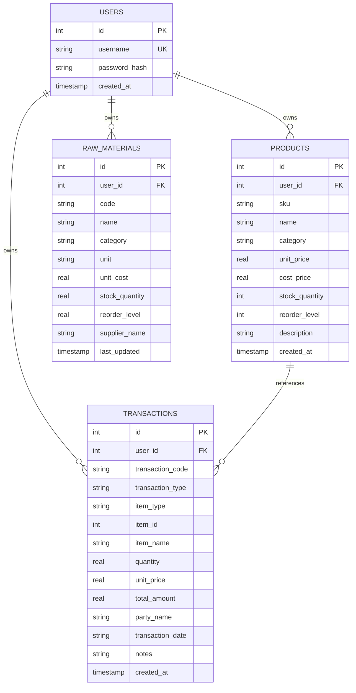

# Inventrack — Inventory & Financial Management System (IFMS)

[](https://www.python.org/)
[](https://streamlit.io/)
[](https://www.sqlite.org/)
[](https://plotly.com/)
[](https://opensource.org/licenses/MIT)

**Inventrack** is a multi-tenant, modern B2B SaaS web platform built for small-to-medium enterprises (SMEs), retailers, and manufacturers. It centralizes real-time inventory tracking, raw material procurement, sales bookkeeping, automated profit-and-loss (P&L) computations, and interactive cash-flow analytics in Indian Rupees (₹).

---

## 🌟 Key Highlights

- **Strict Multi-Tenancy**: Complete row-level database isolation. Every product, transaction, and financial computation is strictly scoped to the authenticated tenant (`user_id`).
- **Dynamic P&L & Cash-Flow Engine**: Zero hardcoded mock numbers. All cards, charts, and badges recalculate dynamically from SQLite transactions using precise weighted cost of goods sold (COGS) models.
- **Pixel-Aligned SaaS UI**: Clean, pastel interface inspired by modern SaaS applications (Inter & Plus Jakarta Sans typography, subtle border radii, high-contrast badges, soft-tinted surfaces).
- **Horizontal Top Tabs Navigation**: Fast, responsive tab navigation with native routing across all views without sidebar clutter.
- **Instant Global Search**: Keyboard shortcut (`/`) enables quick item lookup across products and transaction logs with a dropdown results modal.
- **Proactive Stock Health Alerts**: Real-time warning banners alert you when inventory falls below minimum reorder points.
- **Bulk CSV Data Ingestion**: Automated CSV ingestion pipeline with schema validation, format error detection, and sample template downloads.

---

## 📸 Application Preview & Modules

```
┌──────────────────────────────────────────────────────────────────────────────────────────────────┐
│  ⊟ Inventrack               [ Q  Search items... (Press / to focus) ]                 (?)   (K)  │
├──────────────────────────────────────────────────────────────────────────────────────────────────┤
│  [ 📊 Dashboard ]   [ 📦 Inventory (2 low) ]   [ 📑 Transactions ]   [ 📥 Data import ]  🟢 Live │
├──────────────────────────────────────────────────────────────────────────────────────────────────┤
│                                                                                                  │
│  Welcome back, Khushi                                        [ Record a sale ] [ Import ] [ ↻ ]  │
│  Sunday, 01 November · all amounts in ₹                                                          │
│                                                                                                  │
│  [✓ All time] [ This month ] [ Last 7 days ]   [ All categories ▾ ]                              │
│                                                                                                  │
│  ⚠️  2 items are running low: Notebook A5 and Phone stand. Reorder soon.       [ See low items ]  │
│                                                                                                  │
│  Money in and out                                                                                │
│  ┌────────────────┐ ┌────────────────┐ ┌────────────────┐ ┌────────────────┐                    │
│  │  Total sales   │ │  Cost of stock │ │ Profit on sales│ │ Cash left over │                    │
│  │   ₹12,525.50   │ │   ₹5,636.48    │ │   ₹6,889.02    │ │   ₹10,794.10   │                    │
│  │  ↗ 12% vs last │ │  ↗ 4% of sales │ │  ↗ 14% margin  │ │  ↗ 9% surplus  │                    │
│  └────────────────┘ └────────────────┘ └────────────────┘ └────────────────┘                    │
│                                                                                                  │
│  ┌──────────────────────────────────────────────┐ ┌───────────────────────────┐                  │
│  │ Sales this week (Plotly Bar Chart)           │ │ Stock on shelves (Donut)  │                  │
│  │ Daily Revenue Trend (Mon - Sun)              │ │ Healthy / Low / Out-Stock │                  │
│  └──────────────────────────────────────────────┘ └───────────────────────────┘                  │
└──────────────────────────────────────────────────────────────────────────────────────────────────┘
```

---

## 🚀 Core Features

### 1. Executive Analytics & P&L Dashboard (`app.py`)
- **Key Metrics ("Money in and out")**:
  - **Total Sales**: Aggregate revenue generated from all recorded customer sales.
  - **Cost of Stock Sold (COGS)**: Base product cost associated with sales volume.
  - **Profit on Sales**: Net profit margin ($Sales - COGS$).
  - **Cash Left Over**: Liquid surplus available across operations.
- **Interactive Visualizations**:
  - **Weekly Trend**: Daily revenue variations rendered via Plotly bar charts.
  - **Stock on Shelves**: Donut chart displaying catalog stock health (Healthy, Low Stock, Out of Stock) and total catalog valuation.
- **Sale Modal**: Quick "Record a sale" interface with dynamic unit pricing, stock validation, and instant balance updates.

### 2. Master Inventory Management (`pages/2_Inventory.py`)
- **Finished Products Catalog**:
  - Full CRUD interface (Create, Read, Update, Delete) for finished goods.
  - Tracks SKU, Item Name, Category, Unit Price, Cost Price, Stock Quantity, and Reorder Levels.
- **Raw Materials Inventory**:
  - Tracks components, formulations, suppliers, measurement units (kg, litres, meters, units), and unit costs.
- **Quick Stock Adjustments**:
  - Record manual adjustments (e.g., damaged goods, returned shipments, physical audit reconcile) with audit notes.

### 3. Financial Transaction Ledger (`pages/3_Transactions.py`)
- Complete ledger for **Sales**, **Purchases**, and **Stock Adjustments**.
- Displays transaction codes, timestamps, counterparty names, quantities, and totals.
- Filter by transaction type, counterparty, and custom date windows.
- Export transaction history to CSV.

### 4. Bulk Data Ingestion Engine (`pages/0_Data_Import.py`)
- Batch-import historical records directly into your account's tables.
- Built-in schema validator checks for missing fields, bad data types, and foreign key constraints before committing.
- Provides downloadable CSV templates for Finished Goods, Raw Materials, and Sales logs.

### 5. Multi-Tenant User Authentication
- Persistent user sign-up and sign-in with SHA-256 hashed password storage.
- Session isolation ensures tenants cannot view, alter, or calculate over other users' records.
- Top-right profile popover displays tenant ID and an instant **Log out** action.

---

## 🏗️ Technical Architecture & Stack

| Layer | Technologies / Libraries | Purpose |
|---|---|---|
| **Frontend Framework** | Streamlit `1.56+` | Web app UI and interactive event loop |
| **Data Visualization** | Plotly Express & Plotly Graph Objects | Interactive charts, donuts, and bars |
| **Data Wrangling** | Pandas, NumPy | Financial calculations, time-series, dataframes |
| **Styling & Design System** | Custom CSS3 (`assets/style.css`) | Inter / Plus Jakarta Sans fonts, pastel SaaS theme |
| **Database Engine** | SQLite3 (`data/inventory.db`) | Relational persistence with foreign keys enabled |
| **Security** | Python `hashlib` (SHA-256) | Password hashing and session protection |

---

## 🗄️ Database Schema & Relationships



---

## 📂 Project Directory Structure

```plaintext
IFMS-capstone/
├── app.py                      # Main entrypoint, auth gateway & executive dashboard
├── requirements.txt            # Python dependencies
├── style.css                   # Global stylesheet mirror
├── README.md                   # Project documentation
├── .streamlit/
│   └── config.toml             # Theme settings (palette, typography, navbar hidden)
├── assets/
│   └── style.css               # Primary pixel-aligned SaaS stylesheet
├── components/
│   ├── __init__.py
│   └── nav.py                  # Global top header, search modal & top navigation tabs
├── database/
│   ├── __init__.py
│   └── db_manager.py           # SQLite connection, CRUD queries, schema & P&L engine
├── data/
│   └── inventory.db            # Local SQLite database (auto-created on startup)
└── pages/
    ├── 0_Data_Import.py        # Bulk CSV data ingestion & template engine
    ├── 1_Dashboard.py          # Detailed executive P&L statement & moving averages
    ├── 2_Inventory.py          # Master catalog, raw materials & stock adjustments
    └── 3_Transactions.py       # Full transaction ledger & export tools
```

---

## ⚡ Installation & Local Setup

### Prerequisites
- Python **3.10** or higher installed on your machine.
- `pip` package manager.
- Git (optional, for cloning).

### 1. Clone the Repository
```bash
git clone https://github.com/your-username/IFMS-capstone.git
cd IFMS-capstone
```

### 2. Create and Activate a Virtual Environment
- **On Windows (PowerShell)**:
  ```powershell
  python -m venv .venv
  .venv\Scripts\Activate.ps1
  ```
- **On macOS / Linux**:
  ```bash
  python3 -m venv .venv
  source .venv/bin/activate
  ```

### 3. Install Dependencies
```bash
pip install --upgrade pip
pip install -r requirements.txt
```

### 4. Launch the Application
```bash
streamlit run app.py
```

Streamlit will start local server, typically at:
```
Local URL: http://localhost:8501
Network URL: http://192.168.x.x:8501
```

---

## 📖 User Workflow Guide

1. **Sign Up / Log In**:
   - Open `http://localhost:8501`.
   - Register a new account on the gateway. The system initializes an isolated tenant account in SQLite.
2. **Add Products & Materials**:
   - Navigate to the **Inventory** tab at the top.
   - Use the **Finished Products** tab to register items with selling price, cost price, and stock.
   - Use the **Raw Materials** tab to track unit costs and suppliers.
   - *Alternatively*, open the **Data import** tab and upload a populated CSV template to import records in bulk.
3. **Record Sales & Stock Inflows**:
   - On the **Dashboard**, click the blue **Record a sale** button.
   - Select a product, specify quantity, and confirm. The system validates stock availability, deducts inventory, records a transaction, and updates your financial KPIs instantly.
4. **Monitor Financial Metrics**:
   - View your gross sales, COGS, profit margins, and surplus cash on the **Dashboard**.
   - Switch to **Transactions** to review historical invoices and audit logs.
   - Filter records by date ranges (`All time`, `This month`, `Last 7 days`) or by item category.

---

## 🧪 Testing & Quality Assurance

This codebase uses Streamlit's official `AppTest` framework (`streamlit.testing.v1`) to verify UI components, database operations, and navigation routing without launching an external browser.

To run verification checks:
```bash
# Verify Python syntax and compilation
python -m py_compile app.py components/nav.py database/db_manager.py pages/*.py

# Run comprehensive automated AppTest suite
python -c "
from streamlit.testing.v1 import AppTest
for page in ['app.py', 'pages/0_Data_Import.py', 'pages/1_Dashboard.py', 'pages/2_Inventory.py', 'pages/3_Transactions.py']:
    at = AppTest.from_file(page, default_timeout=30)
    at.session_state['authenticated'] = True
    at.session_state['user_id'] = 1
    at.session_state['username'] = 'test_user'
    at.run()
    assert len(at.exception) == 0, f'Error in {page}'
print('All pages run with 0 exceptions!')
"
```

---

## 🔒 Security Best Practices

- **Zero Plaintext Passwords**: All user credentials are cryptographic SHA-256 hashes.
- **Parameterized SQL**: All database operations use parameterized queries (`?` placeholders) to prevent SQL injection vulnerabilities.
- **Row-Level Tenant Isolation**: All SELECT, INSERT, UPDATE, and DELETE queries strictly enforce `WHERE user_id = ?`.
- **Database Integrity**: SQLite foreign key constraints (`PRAGMA foreign_keys = ON;`) ensure cascading integrity on deletions.

---

## 📄 License

Distributed under the **MIT License**. See `LICENSE` for more information.

---

## 🤝 Acknowledgements

Developed as a Capstone Project for **Inventory & Financial Management Systems (IFMS)**. Built with [Streamlit](https://streamlit.io/), [Plotly](https://plotly.com/), and [SQLite](https://www.sqlite.org/).

